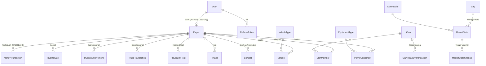

# Datenmodell und Nachvollziehbarkeit

> Verantwortlich: Agent 3 (ADR-022). Fachliches Modell, Invarianten und Regeln.
> Technische Umsetzung (Constraints, Trigger, Migrationsablauf): [`backend/docs/DATA_MODELS.md`](../../backend/docs/DATA_MODELS.md).
> Quelle der Wahrheit für die Struktur: [`backend/prisma/schema.prisma`](../../backend/prisma/schema.prisma). Stand: Datenmodell v2 (T-005).

## 1. Grundsätze

1. **Katalog nur in `parameters.toml`.**
   - Betroffen sind Waren, Orte (Städte und Weltraum), Fahrzeug- und Ausrüstungstypen mit allen Werten und Anzeigenamen.
   - Die Katalogtabellen der Datenbank enthalten nur `id` und den technischen Schlüssel (`slug`), damit Fremdschlüssel und Journale darauf verweisen können.
   - Beim Start legt das Backend fehlende Schlüssel an. Kennt die Datenbank einen Schlüssel, den die Parameter nicht mehr definieren, bricht der Start ab.
2. **Zustand ist Projektion, Journale sind die Wahrheit (ADR-010).**
   - Geld, Warenbestände, Marktzustand und Clan-Kasse ändern sich nur zusammen mit einem Eintrag in einem append-only Journal, in derselben Transaktion.
   - Trigger in der Datenbank verbieten UPDATE und DELETE auf Journalen.
3. **Geld** wird als ganzzahlige Cent in `BigInt` gespeichert (ADR-019). Es gibt zwei Konten (ADR-023):
   - **Bargeld** (`cash`): Schwarzgeld, wird mitgeführt und ist beschlagnahmbar.
   - **Bankkonto** (`bank`): gewaschenes Geld, sicher.
4. **Keine Löschung von Historie.**
   - Ein gelöschtes Konto bleibt als pseudonymisierter Spieler erhalten (ADR-017).
   - Fremdschlüssel von Journalen und Historie verweisen mit `Restrict`.
5. **Dauerhafte Welt (ADR-016):** Migrationen erhalten Daten. Die Journale wachsen unbegrenzt; die Archivierung ist T-507, siehe §6.

## 2. Überblick

| Gruppe           | Tabellen                                                                                                    | Art                                                                           |
| ---------------- | ----------------------------------------------------------------------------------------------------------- | ----------------------------------------------------------------------------- |
| Konten           | `User`, `RefreshToken`                                                                                      | personenbezogen, wird bei Kontolöschung entfernt                              |
| Spieler          | `Player`, `PlayerCityHeat`                                                                                  | Zustand                                                                       |
| Katalog          | `City`, `Commodity`, `VehicleType`, `EquipmentType`                                                         | nur Schlüssel, Werte aus `parameters.toml`                                    |
| Markt            | `MarketState`                                                                                               | Zustand: Bestand S und Rauschen x als Float, aktives Ereignis (economy.md §2) |
| Besitz           | `InventoryLot`, `Vehicle`, `PlayerEquipment`                                                                | Zustand; Lose je Kaufzeitpunkt (Verderb, Einstandspreis)                      |
| Journale         | `MoneyTransaction`, `InventoryMovement`, `TradeTransaction`, `MarketStateChange`, `ClanTreasuryTransaction` | append-only                                                                   |
| Historie         | `Travel`, `Combat`                                                                                          | bleibt bei Kontolöschung erhalten                                             |
| Clans & Soziales | `Clan`, `ClanMember`, `ClanInvite`, `Message`, `Notification`, `TickerEvent`                                | Zustand                                                                       |

## 3. Invarianten

Die folgenden Aussagen müssen jederzeit gelten. Tests in `backend/test/` prüfen sie; neue Schreibaktionen müssen sie erhalten.

| ID  | Invariante                                                                                                                                                                                                                                                                   | Durchgesetzt durch                                                               |
| --- | ---------------------------------------------------------------------------------------------------------------------------------------------------------------------------------------------------------------------------------------------------------------------------- | -------------------------------------------------------------------------------- |
| M-1 | Σ `MoneyTransaction.amount` je (Spieler, `CASH`) = `Player.cash`; dasselbe für `BANK` = `Player.bank`                                                                                                                                                                        | `bookMoney()` (`backend/src/modules/money/ledger.ts`) ist der einzige Schreibweg |
| M-2 | `Player.cash ≥ 0`, `Player.bank ≥ 0`                                                                                                                                                                                                                                         | CHECK + bedingtes Update in `bookMoney()` (`INSUFFICIENT_FUNDS`)                 |
| M-3 | Die Startbuchung `START_CAPITAL` steht im Kontobuch, damit M-1 ab der Registrierung gilt                                                                                                                                                                                     | `createPlayerForUser()`                                                          |
| I-1 | Σ `InventoryMovement.delta` je (Spieler, Ware) = Σ `InventoryLot.quantity`                                                                                                                                                                                                   | Bewegung und Los in derselben Transaktion                                        |
| I-2 | Mengen und `quantityAfter` ≥ 0, `delta ≠ 0`                                                                                                                                                                                                                                  | CHECK                                                                            |
| K-1 | Σ `ClanTreasuryTransaction.amount` je (Clan, Konto) = `Clan.treasuryCash` bzw. `treasuryBank`                                                                                                                                                                                | Kassenbuchungen (T-309)                                                          |
| P-1 | Jede Änderung von Bestand, Rauschen oder Ereignis eines Marktes erzeugt einen `MarketStateChange` mit Ursache (`TRADE`, `TICK`, `EVENT`, `NPC`, …), `refId`, Tick, Version und den Formel-Zwischenwerten (`detail`). Eine Änderung ohne Ursache wird abgelehnt (fail-closed) | DB-Trigger auf `MarketState` (kein Code kann ihn umgehen), CHECKs je Ursache     |
| J-1 | Journale sind unveränderlich, auch gegen `TRUNCATE`                                                                                                                                                                                                                          | DB-Trigger `journal_append_only`, `journal_no_truncate`                          |
| J-2 | Jede Journalzeile trägt Tick, `correlationId` (eine je fachlicher Aktion) und Akteur (`PLAYER` mit Spieler, `NPC`, `SYSTEM`, `ADMIN`). Ohne Journalkontext lehnt die DB die Zeile ab                                                                                         | DB-Defaults aus `set_journal_context()`, CHECK; `setJournalContext()` im Service |
| J-3 | Die Reihenfolge ist eindeutig: `seq` je Journal, dazu `version` lückenlos je Markt                                                                                                                                                                                           | Sequenz bzw. Trigger, unique                                                     |
| L-1 | `Player.status = DELETED` ⇔ `userId IS NULL` ⇔ `deletedAt` gesetzt                                                                                                                                                                                                           | CHECK                                                                            |
| R-1 | Ein Spieler mit Journal- oder Historieneinträgen kann nicht gelöscht werden, ebenso wenig ein Katalogschlüssel mit Journaleinträgen                                                                                                                                          | FK `Restrict`                                                                    |

**Hinweis zu Marktpreisen:** Preise werden nicht gespeichert. Sie ergeben sich per Formel (economy.md) aus dem Marktzustand und den Parametern. Mit dem Journal `MarketStateChange` und der jeweils gültigen `parameters.toml` lässt sich jeder historische Preis rekonstruieren.

## 4. Gründe für Geldbewegungen

`MoneyTransactionReason` bildet die Quellen und Senken aus [`docs/balancing/GAME_ECONOMY.md`](../balancing/GAME_ECONOMY.md) §6 ab. Daraus lässt sich die Geldbilanz der Welt berechnen (Simulation, Agent 5):

- **Quellen:** `START_CAPITAL`, `TRADE_SELL`, `VEHICLE_SALE`, `EQUIPMENT_SALE`, `LOOT_GAINED` (z. B. NPC-Kuriere), `BUSINESS_INCOME`, `EMERGENCY_LOAN`.
- **Senken:** `TRADE_BUY`, `TRAVEL_FUEL`, `TRAVEL_TICKET`, `BRIBE`, `CONFISCATION`, `VEHICLE_BUY`, `EQUIPMENT_BUY`, `CREW`, `BUSINESS_UPKEEP`, `LOAN_REPAYMENT`, `ACCOUNT_DELETION`.
- **Umbuchungen:**
  - `LAUNDERING` verschiebt Geld von Bargeld auf das Bankkonto. Das sind zwei Buchungen; die Gebühr ist eine Senke.
  - `LOOT_LOST` und `LOOT_GAINED` bilden ein Paar zwischen zwei Spielern; der Hehlerabschlag ist eine Senke.
  - `CLAN_DEPOSIT`, `CLAN_PAYOUT` und `CLAN_TAX` buchen zwischen Spieler und Clan-Kasse.
- **Sonstiges:** `ADMIN`.

Die Regeln für Wäsche und Beschlagnahme legt T-120 fest (Agent 2 + Agent 5). Die Gründe existieren bereits, die Logik folgt.

## 5. Kontolöschung (ADR-017, `account.deletion_policy = "forfeit"`)

| Bestandteil                                                                                       | Behandlung                                                                                                                                                                                                     |
| ------------------------------------------------------------------------------------------------- | -------------------------------------------------------------------------------------------------------------------------------------------------------------------------------------------------------------- |
| `User` (E-Mail, Benutzername, Passwort-Hash, Altersbestätigung), Sitzungen samt IP und User-Agent | gelöscht                                                                                                                                                                                                       |
| Spieler                                                                                           | bleibt mit Pseudonym „Gelöschter Spieler #…“, Status `DELETED` und `userId = null`. Er erscheint nicht mehr in Ranglisten und in der Online-Liste                                                              |
| Bargeld, Bankkonto                                                                                | per Buchung `ACCOUNT_DELETION` auf 0 gesetzt (Geldsenke)                                                                                                                                                       |
| Waren                                                                                             | per `InventoryMovement` (`ACCOUNT_DELETION`) auf 0, die Lose werden entfernt. Die Waren gehen **nicht** zurück in die Märkte                                                                                   |
| Fahrzeuge, Ausrüstung, Heat, Benachrichtigungen, offene Einladungen, empfangene Nachrichten       | gelöscht                                                                                                                                                                                                       |
| Gesendete Nachrichten                                                                             | Betreff entfernt, Text wird durch „[gelöscht]“ ersetzt                                                                                                                                                         |
| Journale, Reisen, Kämpfe                                                                          | bleiben vollständig erhalten                                                                                                                                                                                   |
| Clan                                                                                              | Austritt. Ist der Clan danach leer, wird er aufgelöst (`dissolvedAt`): Die Kasse verfällt per Buchung `DISSOLUTION`, und der Clan bleibt für die Journale erhalten. Die Wahl eines neuen Paten folgt mit T-309 |

## 6. Wachstum und Archivierung (T-507, Konzept)

- **Wachstum:** Am stärksten wachsen `MarketStateChange` (bis zu einem Eintrag pro Markt und Tick) und `MoneyTransaction`.
- **Vorschlag:** Partitionierung nach Monat über `createdAt` (PostgreSQL Range Partitioning, in einer Prisma-Migration). Alte Partitionen werden nach einer Frist in ein Archiv-Schema verschoben und dort nur noch gelesen.
- **Voraussetzung:** Die Invarianten M-1 und I-1 müssen über Archivgrenzen hinweg berechenbar bleiben. Dafür gibt es Saldo-Schnappschüsse je Spieler und Archivgrenze.
- **Stand:** noch nicht umgesetzt (M5).

## 7. Stand der Review-Befunde (REVIEW-v2.md, PR #40)

Das Review aus der früheren Database-Architect-Session ist Input für Agent 3 (ADR-022). Umgesetzt wurde nach Entscheidung des Product Owners zuerst der Kern, der vor T-104 und T-106 stehen muss. Der Rest kommt mit der Aufgabe, die ihn braucht.

| Befund | Inhalt                                                                   | Stand                                                                                              |
| ------ | ------------------------------------------------------------------------ | -------------------------------------------------------------------------------------------------- |
| G-1    | Tick an allen Journalen                                                  | ✅ Spalte und Kontext (Migration `…_journal_context`, TD-022). `WorldTick` und FK folgen mit T-104 |
| G-2    | `correlationId` je Aktion                                                | ✅                                                                                                 |
| G-3    | Marktjournal fail-closed, Version, `detail`, Restdauer                   | ✅ inkl. Pflichtschlüssel je Ursache (REVIEW §5, Agent 5)                                          |
| G-3b   | Reihenfolge `seq`                                                        | ✅                                                                                                 |
| G-3c   | TRUNCATE-Schutz                                                          | ✅                                                                                                 |
| G-4    | Wäsche- und Ereignisjournal (`LaunderingEntry`, `GameEvent` mit p und U) | mit T-121, nach T-120 (PR #34)                                                                     |
| G-5    | Wahl, Stimmen, Kassensperre                                              | mit T-309, nach den Wahlregeln von Agent 2                                                         |
| G-6    | Akteur                                                                   | ✅ zusammen mit G-1/G-2, weil es denselben Kontext nutzt                                           |
| G-7    | `ParameterSet`                                                           | mit T-104                                                                                          |
| G-8    | Saldo-Kette und Projektionsprüfung in der DB                             | mit T-106, siehe die Entscheidung unten                                                            |
| G-9    | Besitzjournal Fahrzeuge/Ausrüstung                                       | mit T-204 bzw. T-121 (Notkredit)                                                                   |
| G-10a  | Löschstatus als CHECK                                                    | ✅ L-1                                                                                             |
| G-10b  | IDs statt Namen in Ticker und Kampflog                                   | mit T-401 bzw. dem Ticker-Schreibweg                                                               |
| G-11   | `CommandLog`                                                             | mit T-106                                                                                          |
| G-12   | Löschfristen IP/User-Agent                                               | T-605, Entscheidung des Product Owners offen                                                       |
| G-13   | Archiv-Prüfsumme                                                         | mit T-507                                                                                          |
| G-14   | Vermögens-Schnappschüsse (laut Agent 5 jetzt P2)                         | mit T-508 bzw. dem Tick-Job                                                                        |

**Entscheidung zu G-8 (Frage an Agent 3 in REVIEW §4):** Kette plus aufgeschobene Projektionsprüfung, **nicht** Journal-first.

- `bookMoney()` bleibt der einzige Schreibweg. Die Geschäftslogik (Überziehungsschutz, Gründe, Konten) bleibt im Service, wo sie getestet und für die Simulation lesbar ist.
- Die DB prüft zusätzlich zwei Dinge. Ein BEFORE-INSERT-Trigger prüft, dass jede Zeile die Saldo-Kette über `seq` fortsetzt. Ein aufgeschobener Constraint-Trigger prüft beim COMMIT, dass die Projektion dem letzten `balanceAfter` entspricht. Damit fällt auch ein direktes `player.update({ cash })` auf.
- Journal-first würde die Projektion in Trigger verlagern. Das wäre eine größere Architekturänderung (Abstimmung mit Agent 1) ohne zusätzlichen Schutz.
- Umgesetzt wird das mit T-106, wenn die ersten Handelsbuchungen entstehen.
