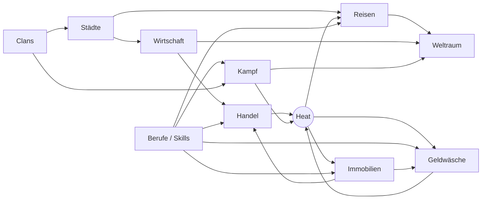

# Game Design – Systemübersicht

Dieses Verzeichnis ist die **verbindliche Spezifikation aller Spielregeln** von *Drogendealer-Reboot*.
Jede Regel ist als Formel mit ID, Parametern, Grenzwerten und mindestens einer nachgerechneten
Beispielrechnung dokumentiert. Ein Entwickler soll jedes System allein anhand dieser Dateien
implementieren können – ohne Interpretationsspielraum.

| Dokument | System | Verantwortlichkeit | Formel-Präfix |
|---|---|---|---|
| [economy.md](economy.md) | Wirtschaft | Angebot, Nachfrage, Preise, Marktbewegungen | `F-ECO` |
| [trade.md](trade.md) | Handel | Einkauf, Verkauf, Lagerbestände | `F-TRD` |
| [cities.md](cities.md) | Städte | Bedarf, Warenverfügbarkeit, Besonderheiten, Heat | `F-CTY` |
| [travel.md](travel.md) | Reisen | Fahrzeuge, Treibstoff, Reisekosten, Kapazität, Kontrollen | `F-TRV` |
| [professions.md](professions.md) | Berufe | Die fünf Betätigungsfelder (keine Klassen) | `F-PRF` |
| [combat.md](combat.md) | Kampf | Angriff, Verteidigung, Kampfkraft | `F-CMB` |
| [clans.md](clans.md) | Clans | Zusammenschlüsse, Hierarchien, Paten, Gebiete | `F-CLN` |
| [money-laundering.md](money-laundering.md) | Geldwäsche | Illegales und legales Vermögen | `F-ML` |
| [real-estate.md](real-estate.md) | Immobilien | Bordelle und weitere Geschäftsmodelle, Produktion | `F-RE` |
| [space.md](space.md) | Weltraum | Fortgeschrittene Spielwelt und besondere Waren | `F-SPC` |

Ergänzend:

- [`parameters.toml`](parameters.toml) – **Single Source of Truth** für jeden Zahlenwert. In den Dokumenten
  werden Parameter als Schlüssel referenziert, z. B. `economy.elasticity` oder `goods.kokain.base_price`.
- [`tools/verify.py`](tools/verify.py) – Referenzimplementierung jeder Formel. Rechnet alle Beispiele nach,
  prüft Balancing-Invarianten und die Konsistenz zwischen Dokumenten und Parametern.

```bash
python3 docs/game-design/tools/verify.py
```

Die Prüfung läuft zusätzlich in der CI (`.github/workflows/design-check.yml`). **Eine Regeländerung ist erst
vollständig, wenn Dokument, `parameters.toml`, `verify.py` und die Beispielwerte übereinstimmen.**

---

## 1. Spielmodell

- **Multiplayer-Browserspiel.** Alle Spieler eines Servers teilen sich die Märkte: Kauft ein Spieler Kokain
  in Rotterdam, steigt der Preis für alle anderen.
- **Echtzeit-Ticks.** 1 Tick = `meta.tick_minutes` = 10 Minuten, 1 Tag = `meta.ticks_per_day` = 144 Ticks.
  Alle Raten in den Dokumenten gelten **pro Tick**, sofern nicht anders angegeben.
- **Aktionen sind sofort, Zustände entwickeln sich pro Tick.** Ein Kauf verändert den Marktbestand sofort;
  die Erholung des Marktes, Erträge, Heat-Zerfall usw. werden im Tick verarbeitet.
- **Keine Klassen.** Jeder Spieler kann jede Tätigkeit ausüben, siehe [professions.md](professions.md).
- **Start:** `player.start_cash_black` = 200 000 ct (2 000 €) Schwarzgeld, kein Fahrzeug,
  Rucksack mit `player.backpack_capacity` = 60 Volumeneinheiten.

## 2. Zahlen- und Rundungskonventionen

| Größe | Darstellung | Regel |
|---|---|---|
| Geld | `int64` in **Cent** (ct) | Niemals Float speichern. Zwischenrechnungen in `float64`, Rundung **nur am Ende** einer Formel. |
| Spieler zahlt | ⌈x⌉ | Aufrunden (Kaufkosten, Gebühren, Strafen, Treibstoff). |
| Spieler erhält | ⌊x⌋ | Abrunden (Verkaufserlöse, Erträge, Beute). Verhindert, dass Rundung Geld erzeugt. |
| Anzeigepreise | kaufmännisch | Nur für die UI, nie für Buchungen. |
| Mengen | `int` | Ganze Einheiten. Abgeleitete Mengen (Verderb, Produktion, Verluste) werden abgerundet, Crew-Verluste kaufmännisch gerundet. |
| Wahrscheinlichkeiten | `float64` in [0, 1] | Immer geklemmt. Ereignis tritt ein, wenn $U < p$. |
| Heat | `float64` in [0, `heat.max`] | Pro (Spieler, Stadt). |
| Bestände | `float64` | Marktbestände sind kontinuierlich; Spielerbestände ganzzahlig. |

Für Float-Vergleiche bei Rundung gilt eine Toleranz von $10^{-9}$ (siehe `ceil_ct`/`floor_ct` in `verify.py`).

## 3. Zufall (deterministisch und auditierbar)

Jede Zufallsentscheidung muss reproduzierbar sein (Support, Cheat-Analyse, Replays). Daher kein globaler
RNG-Zustand, sondern ein Hash pro Entscheidung.

**F-GLB-01 – Gleichverteilung**

```math
U(\text{seed}, t, e, k) = \frac{\operatorname{int}_{64}\big(\operatorname{SHA256}(\texttt{"seed:t:e:k"})[0..8]\big)}{2^{64}} \in [0, 1)
```

- `seed` – geheimer Server-Seed, `t` – Tick, `e` – Entitäts-ID (z. B. `berlin/gras`, `fight/8812`),
  `k` – laufender Index, falls eine Entscheidung mehrere Zufallszahlen braucht.
- Bytes 0–7 des Digests als Big-Endian-Integer ohne Vorzeichen.

**F-GLB-02 – Standardnormalverteilung (Box-Muller)**

```math
Z = \sqrt{-2 \ln(1 - U_{2k})} \cdot \cos(2\pi \, U_{2k+1})
```

**EX-GLB-01 – Testvektor für Implementierungen**

| Eingabe | Ergebnis |
|---|---|
| $U(\texttt{demo-server}, 1, \texttt{berlin/gras}, 0)$ | 0,525072 |
| $Z(\texttt{demo-server}, 1, \texttt{berlin/gras}, 0)$ | −1,191398 |

Jede Implementierung (Server, Tests) muss exakt diese Werte liefern.

## 4. Tick-Reihenfolge

Die Reihenfolge ist verbindlich, weil Systeme voneinander abhängen. Alle Schritte eines Ticks verwenden
denselben Tick-Index `t`.

1. **Ereignisse** – Marktereignisse würfeln/auslaufen lassen (F-ECO-09).
2. **Märkte** – Rauschen (F-ECO-05), Bestand Richtung Ziel (F-ECO-04), Preis neu (F-ECO-06).
3. **Reisen** – Ankünfte verarbeiten; Kontrollen (F-TRV-04) und Piraten (F-SPC-04) werden **bei Abfahrt**
   pro Segment vorab gewürfelt und beim Erreichen des Segment-Ticks ausgelöst.
4. **Betriebe** – Erträge und Unterhalt (F-RE-01, F-RE-02), Produktion (F-RE-06), Razzien (F-RE-05).
5. **Geldwäsche** – Gutschriften (F-ML-01) und Entdeckung (F-ML-03).
6. **Clans** – Schutzgeld (F-CLN-04), Steuern (F-CLN-03), Kriegsstatus.
7. **Spielerzustand** – Crew-Unterhalt, HP-Regeneration (F-CMB-07), Heat-Zerfall (F-CTY-01).

Kein Schritt darf Zustand aus einem späteren Schritt desselben Ticks lesen.

## 5. Systemabhängigkeiten



## 6. Zwei Geldarten

| | Schwarzgeld | Weißgeld |
|---|---|---|
| Herkunft | Drogenverkauf, Beute, Schutzgeld | legale Betriebserträge, Geldwäsche |
| Aufbewahrung | Bargeld beim Spieler | Bankkonto |
| Plünderbar | ja (F-CMB-05) | nein |
| Verwendbar für | Waren, Waffen, Crew, Fahrzeuge, Bestechung, Treibstoff | alles; **exklusiv**: Immobilien, Clan-Gründung/-Ausbau, Raumschiffe |

Details in [money-laundering.md](money-laundering.md).

## 7. Nettovermögen

Wird für Anfängerschutz, Vermögensband (Kampf) und die Weltraum-Freischaltung verwendet:

$$NW = \text{Schwarzgeld} + \text{Weißgeld} + \sum \text{Kaufpreise Fahrzeuge, Waffen, Rüstung} + \sum \text{Investition Betriebe} + \sum_i q_i \cdot P_{base,i}$$

Waren werden mit dem Basispreis bewertet (nicht mit dem Marktpreis), damit Marktbewegungen den Schutzstatus
nicht flackern lassen.

## 8. Glossar

| Begriff | Bedeutung |
|---|---|
| Tick | 10 Minuten Echtzeit, kleinste Zeiteinheit der Simulation |
| Markt | Kombination aus Stadt und Ware |
| Heat $H$ | Fahndungsdruck eines Spielers in einer Stadt, 0–100 |
| Polizei $\pi$ | Polizeistärke einer Stadt, 0–1 |
| Π | Fahndungsdruck $\pi \cdot (1 + H/100)$ (F-CTY-02) |
| $W$ | Wohlstand einer Stadt (1,0 = Durchschnitt) |
| Level $L$ | Fähigkeitsstufe in einem Betätigungsfeld, 0–20 |
| Ausbaustufe $A$ | Ausbau eines Betriebs, 0–5 |
| Clanstufe | 1–5 |
| ct | Cent, interne Geldeinheit |

## 9. Konventionen für Änderungen

1. Wert in `parameters.toml` ändern (bei Bedarf Wertebereich in `[bounds]` ergänzen).
2. Formel in `verify.py` anpassen, falls sich die Regel ändert.
3. `python3 docs/game-design/tools/verify.py --print` ausführen und die betroffenen Beispielwerte
   in Dokument **und** `EXPECTED` in `verify.py` aktualisieren.
4. `python3 docs/game-design/tools/verify.py` muss mit „ALLE PRÜFUNGEN BESTANDEN“ enden.
